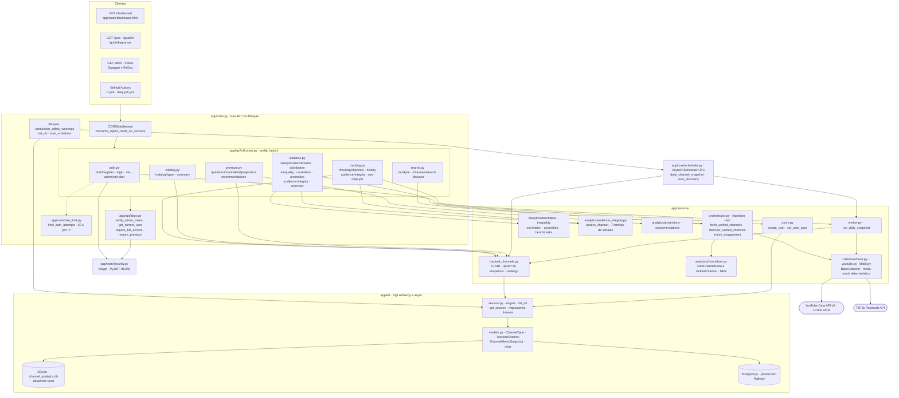
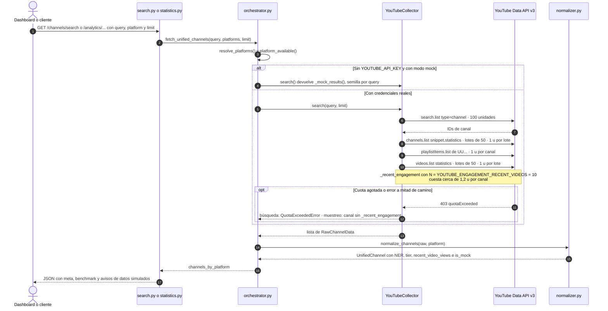
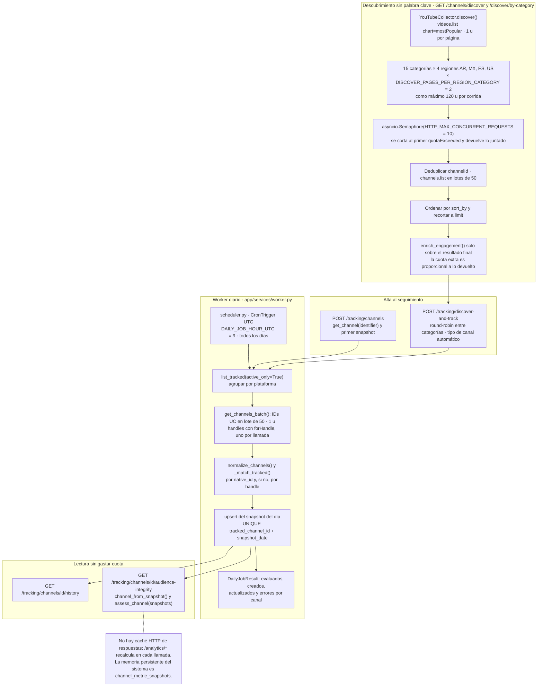
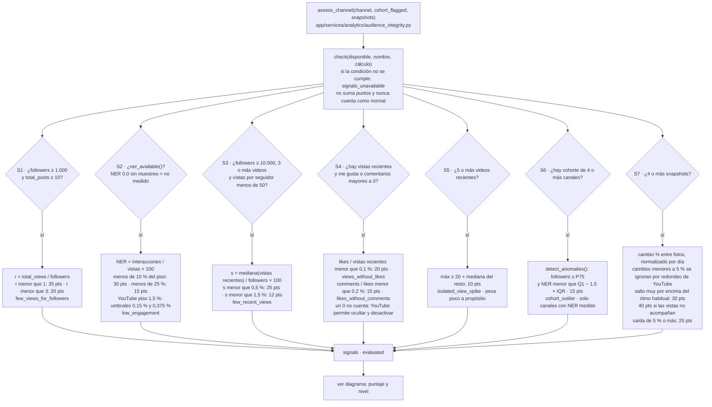
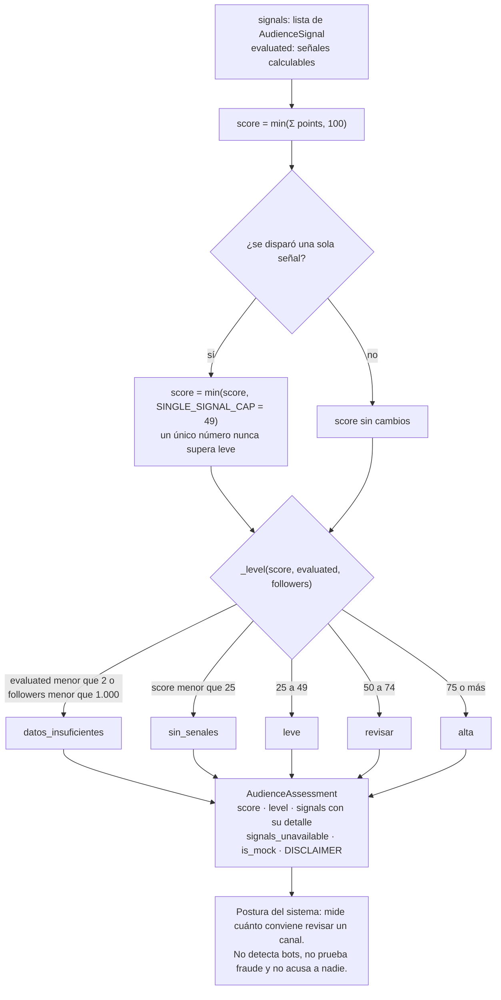
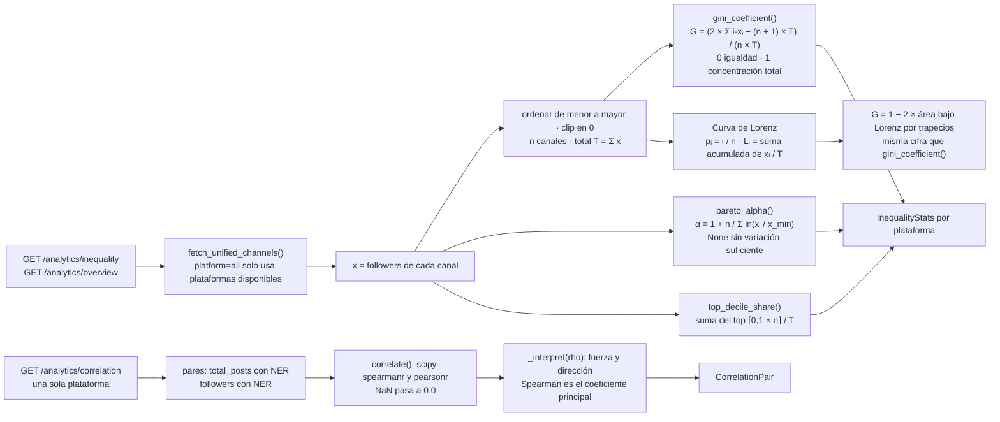
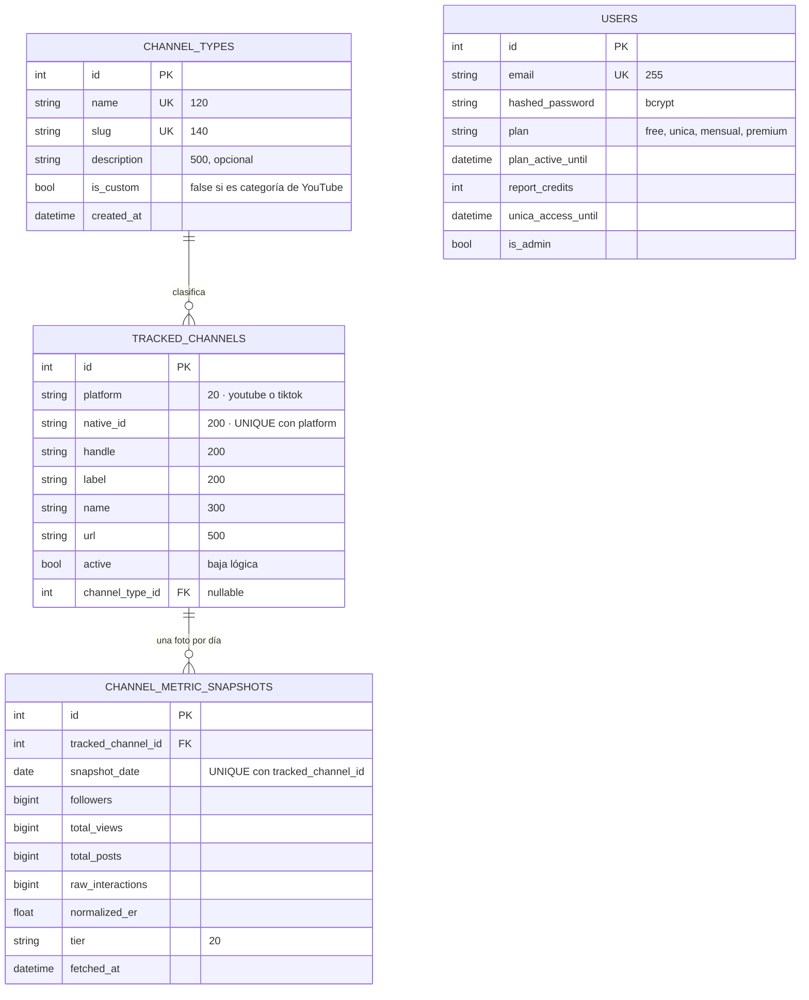
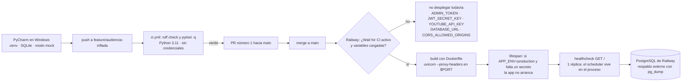

# Grafos técnicos del sistema

> Las señales de audiencia marcan anomalías estadísticas públicas para que un anunciante o auditor las revise con prudencia. El sistema no detecta bots ni acusa a nadie.

Cómo funciona Channel Analytics por dentro: arquitectura, ingesta desde YouTube, motor de señales de audiencia, desigualdad digital, modelo de datos y despliegue. Cada nodo cita el archivo o la función real del repositorio.

<!-- Generado por scripts/generar_diagramas.py (Mermaid 12.3.0). No editar a mano. -->

## 1. Arquitectura de software

Rutas FastAPI, dependencias de acceso, servicios, colectores y persistencia SQLite o PostgreSQL.

## 2. Pipeline de ingesta desde YouTube Data API

Estrategia de dos pasos para cuidar la cuota diaria de 10.000 unidades y muestreo del NER.

## 3. Descubrimiento, seguimiento y worker diario

De dónde salen los canales, cómo se guarda un snapshot por día y qué se puede leer sin gastar cuota.

## 4. Motor de las 7 señales de audiencia

Condición de disponibilidad, fórmula y puntos de cada señal. Una señal sin datos no cuenta a favor ni en contra.

## 5. Reglas de prudencia, puntaje 0 a 100 y nivel

Tope por señal única, evidencia mínima y clasificación final.

## 6. Desigualdad digital: Gini, Lorenz, Pareto y correlaciones

Qué tan concentrada está la audiencia dentro de una búsqueda y cómo se relacionan las variables.

## 7. Modelo de datos

Tablas de app/db/models.py. Idénticas en SQLite y PostgreSQL; las métricas son BIGINT.

## 8. Flujo de integración y despliegue

Del entorno local en Windows a Railway, sin desplegar antes de tener los secretos cargados.

