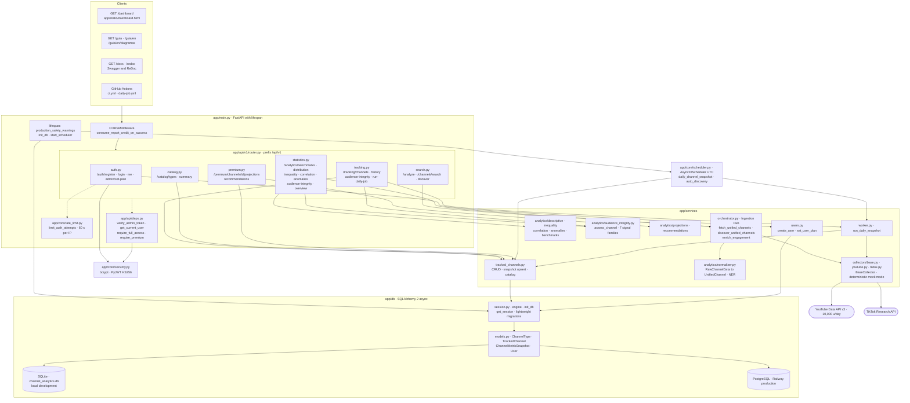
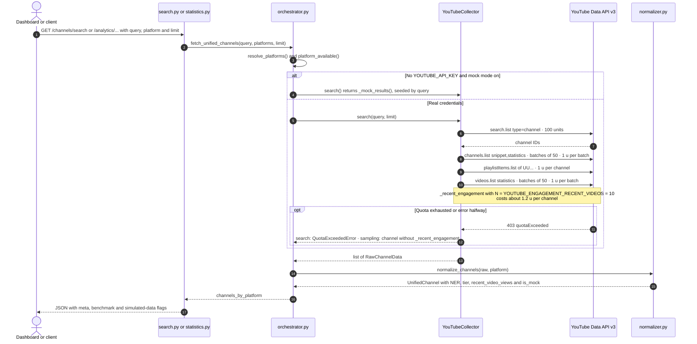
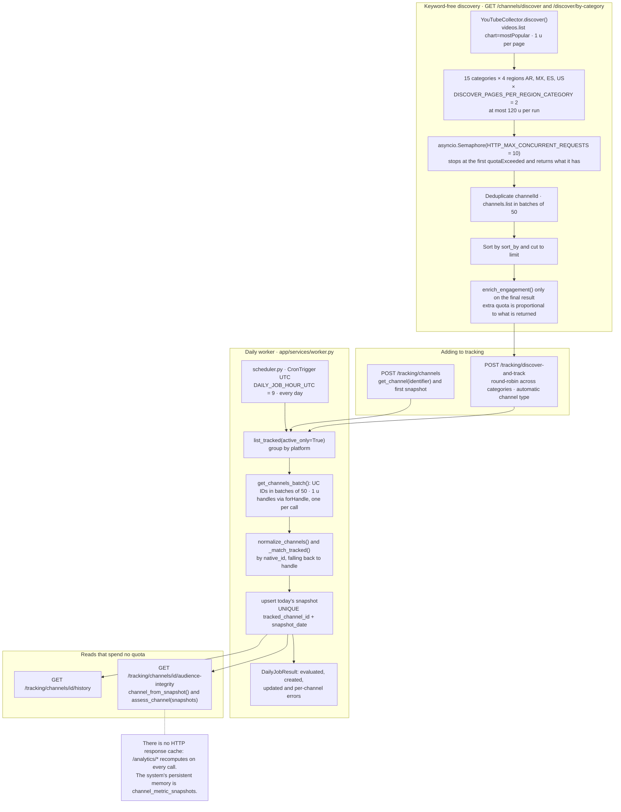
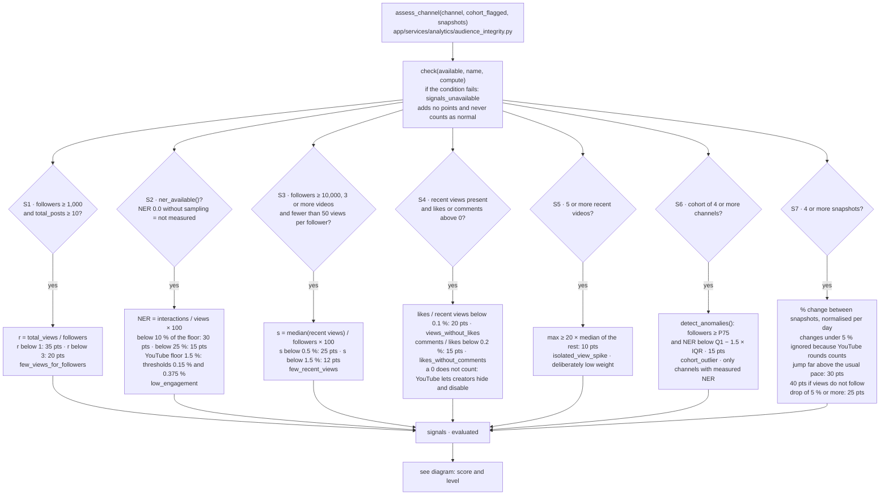
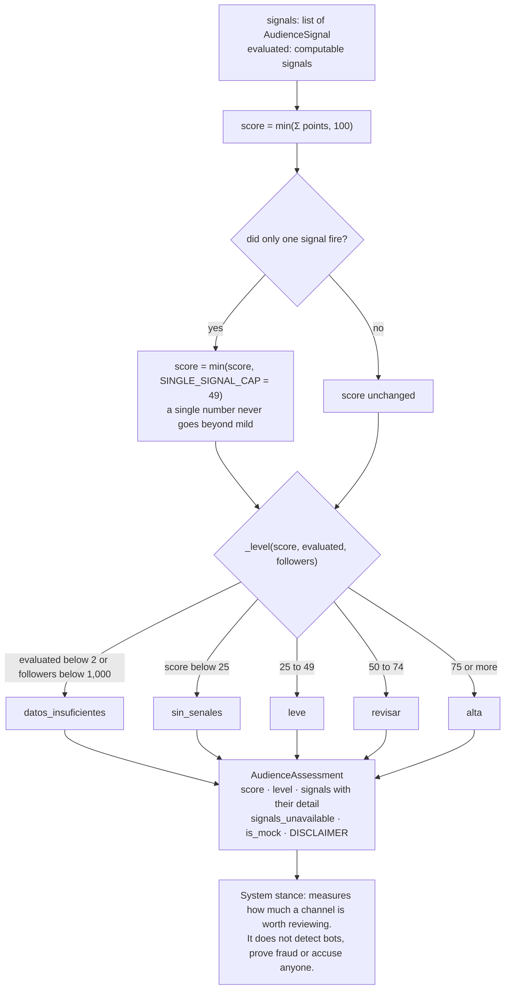
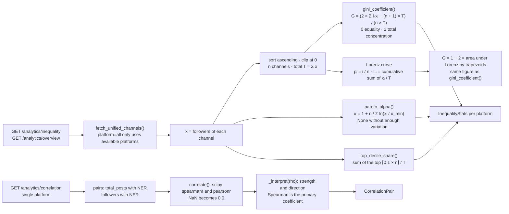
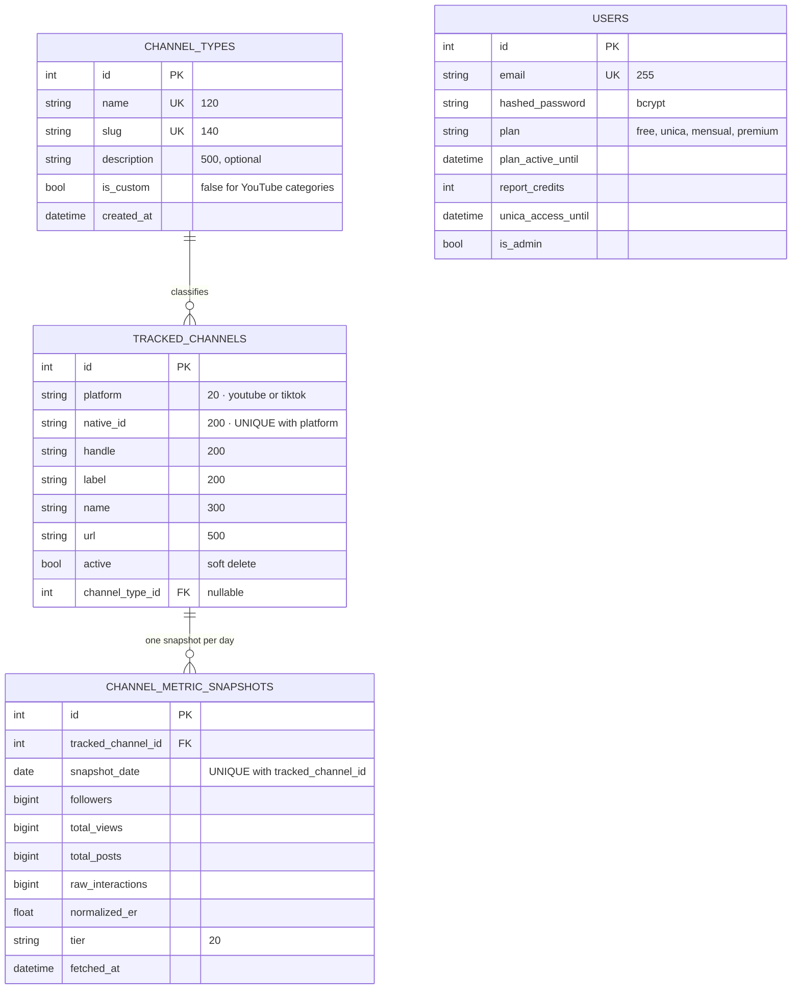
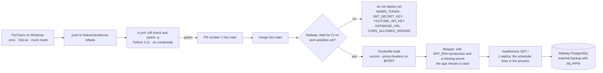

# System technical graphs

> Audience signals point out public statistical anomalies for an advertiser or auditor to review carefully. The system does not detect bots or accuse anyone.

How Channel Analytics works inside: architecture, YouTube ingestion, the audience signal engine, digital inequality, data model and deployment. Every node names the real file or function in the repository.

<!-- Generado por scripts/generar_diagramas.py (Mermaid 12.3.0). No editar a mano. -->

## 1. Software architecture

FastAPI routes, access dependencies, services, collectors and SQLite or PostgreSQL persistence.

## 2. YouTube Data API ingestion pipeline

Two-step strategy to protect the 10,000-unit daily quota, plus NER sampling.

## 3. Discovery, tracking and the daily worker

Where channels come from, how one snapshot per day is stored and what can be read without quota.

## 4. The 7 audience signal engine

Availability condition, formula and points of each signal. A signal without data counts neither way.

## 5. Prudence rules, 0 to 100 score and level

Single-signal cap, minimum evidence and final classification.

## 6. Digital inequality: Gini, Lorenz, Pareto and correlations

How concentrated the audience is within a search and how variables relate.

## 7. Data model

Tables in app/db/models.py. Identical in SQLite and PostgreSQL; metrics are BIGINT.

## 8. Integration and deployment flow

From the local Windows environment to Railway, without deploying before secrets are set.

